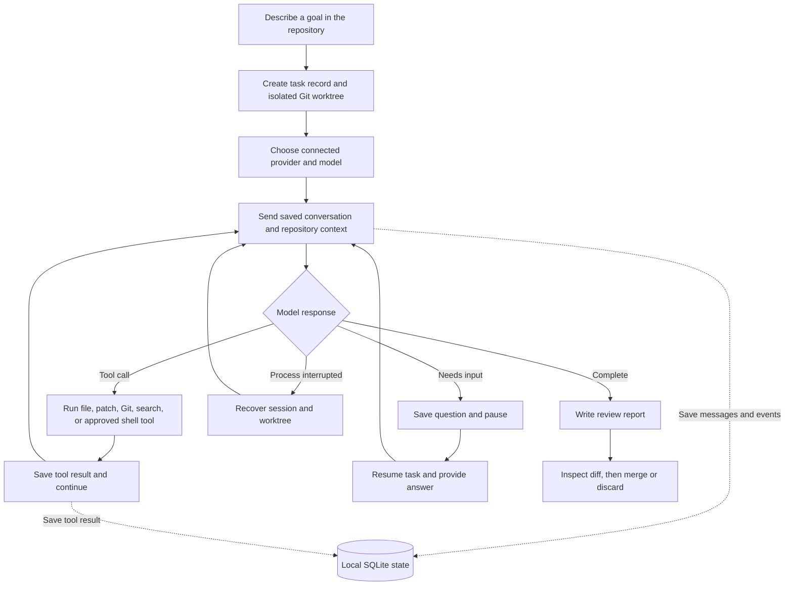

# Everrun

**A standalone coding harness for work that takes more than one prompt.**

Everrun opens an interactive coding session in your repository. It runs its own model-and-tools loop, works in an isolated Git worktree, and saves conversation history and checkpoints locally. Keep chatting as the work evolves, pause and resume later, then review the changes before merging.

## What Everrun does

- **Owns the coding loop.** Everrun sends context to the selected model, dispatches its tool calls, collects results, and continues until the task is complete or needs your input.
- **Surfaces empty model turns.** A completed response with no text or tool calls is recorded with provider diagnostics and retried once before the session pauses.
- **Keeps long tasks resumable.** Task state, messages, tool results, and compacted context checkpoints are stored in SQLite.
- **Prevents duplicate workers.** Everrun locks each session while it is active, including its interactive prompt and tool execution.
- **Recovers interrupted tool turns.** Everrun checkpoints streamed shell output. If a process stops during a tool call, resume includes the recorded result or captured partial output and tells the model to inspect state before considering the action again.
- **Keeps task edits separate.** Every task gets its own Git branch and worktree.
- **Starts from your current checkout.** A new task includes tracked edits and untracked files already in the repository, so it can work on the code you have open before you commit it.
- **Uses models directly.** Connect OpenAI, Anthropic, OpenRouter, or an OpenAI-compatible endpoint. Everrun does not launch Codex CLI or Claude Code.
- **Hands back reviewable work.** A completed task includes a report with its goal, criteria, agent summary, diff summary, and provider-reported token usage when available. Everrun does not infer billed cost or merge changes for you.

## Workflow



## Install

Requires Python 3.11+ and Git.

For a globally available `everrun` command, install it as a uv tool:

```sh
uv tool install --editable .
```

Run this from the Everrun checkout. `uv tool` places the command in its tool bin directory; if your shell still cannot find `everrun`, run `uv tool update-shell` and open a new terminal. To work on Everrun itself, use a project virtual environment instead:

```sh
uv venv --python 3.12 .venv
uv pip install --python .venv/bin/python -e .
source .venv/bin/activate
```

Run the local regression suite from the checkout with:

```sh
.venv/bin/python -m unittest discover -s tests -v
```

## Connect a provider

### Sign in with ChatGPT

Connect Everrun to your ChatGPT account in a browser, then use an eligible ChatGPT plan for model requests. No OpenAI API key is needed for this sign-in path:

```sh
everrun auth login openai
everrun models --provider openai
```

Requests use your ChatGPT plan’s available usage and limits, shared with other apps using that plan. Check or manage app usage in [ChatGPT settings](https://chatgpt.com/#settings/Usage). `everrun auth status` shows whether Everrun is connected through ChatGPT or an API key.

OpenAI API keys are also supported with `everrun auth set openai` or `OPENAI_API_KEY`; API-key requests are billed separately through the OpenAI API account.

### Anthropic

Create an API key in the Anthropic Console and connect it:

```sh
everrun auth set anthropic
everrun models --provider anthropic
```

Claude.ai subscriptions and Anthropic API access are separate products; a Claude subscription does not include Console API usage.

### Google Antigravity & Gemini

Connect Google Gemini models (e.g. `gemini-2.5-pro`, `gemini-2.5-flash`, `gemini-2.0-flash`) or the Google Antigravity SDK:

```sh
everrun auth set gemini          # or: everrun auth set antigravity
everrun models --provider gemini
```

You can also export `GEMINI_API_KEY`, `ANTIGRAVITY_API_KEY`, or `GOOGLE_API_KEY` in your environment. Everrun can use the `google-antigravity` SDK when installed or communicate with Google's high-speed API directly.

### OpenRouter or another compatible endpoint

```sh
everrun auth set openrouter
everrun models --provider openrouter
```

For an OpenAI-compatible server such as a local model endpoint:

```sh
everrun auth set openai-compatible
everrun models --provider openai-compatible
```

Everrun stores saved credentials in `~/.everrun/auth.json` with owner-only file permissions. You can provide provider keys through environment variables instead.

## Start a task

From the repository you want to work in, start an interactive session:

```sh
cd ~/code/my-project
everrun
```

On first use, Everrun selects the only connected provider automatically. If several providers are connected, it asks which one to use; it then lets you choose a model and remembers both choices. It opens a full-screen terminal session in your repository, where you can start a task or resume one of the saved sessions. Enter sends a message; Ctrl+O adds a line to a multi-line message. Use `/help` to see session commands: `/files` lists repository files, `/diff` reviews task changes, and `/compact` writes a durable conversation checkpoint. `/exit` pauses and saves; `/done` creates a review report.

For one-shot or automated tasks, start directly:

```sh
everrun run "Add pagination to the projects API" \
  --repo ~/code/my-project \
  --provider openai \
  --model <model-id> \
  --accept "Existing API behavior remains compatible" \
  --accept "Pagination has tests for first, middle, and final pages"
```

Shell commands require approval by default. Add `--auto-approve` to let the model run commands without asking each time:

```sh
everrun run "Fix the failing tests" --repo ~/code/my-project \
  --provider anthropic --model <model-id> --auto-approve
```

For a no-argument interactive session, set `EVERUN_AUTO_APPROVE=1` to enable the same behavior. Use it only in a trusted, disposable environment:

```sh
EVERUN_AUTO_APPROVE=1 everrun
```

## Track and resume

```sh
everrun list
everrun status <task-id>
everrun report <task-id>
everrun resume <task-id>
everrun resume <task-id> --answer "Use cursor pagination"
```

In an interactive session, `/exit` pauses and saves the conversation; `/compact` summarizes and checkpoints the current context; `everrun resume <task-id>` reopens it. Ctrl-C also pauses the session. Resume continues from Everrun's saved conversation and worktree; it does not depend on an external coding-agent session.

## Local state and safety

- Task records, events, messages, and checkpoints: `~/.everrun/state.sqlite3`
- Provider credentials: `~/.everrun/auth.json`
- Reports: `~/.everrun/tasks/<task-id>/`
- Task branches and worktrees: `.git/everrun-worktrees/<task-id>` in the repository's common Git directory

Set `EVERUN_HOME` to move Everrun's database, credentials, and reports.

Provider requests allow up to 15 minutes for a response by default. Set `EVERUN_REQUEST_TIMEOUT` to a value from 60 to 3600 seconds to change that limit.

The worktree keeps changes isolated from your current checkout, but it is not a security sandbox. Shell commands run on your machine. Review commands before approving them, use repositories you trust, and inspect the report and diff before merging. Everrun records model-reported checks but does not independently validate them.

See the [comparison protocol](benchmarks/PROTOCOL.md) for a reproducible Everrun vs. Codex evaluation. Everrun has not been shown to outperform Codex until that protocol has been run and its results published.
