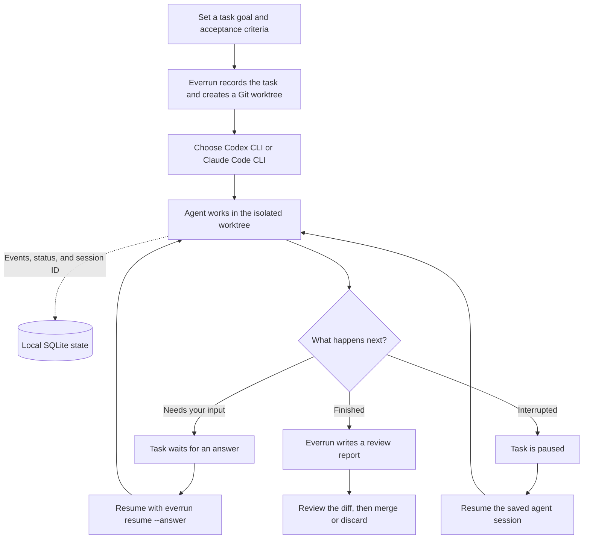

# Everrun

**Long-running coding tasks, with durable state and a clean handoff.**

Everrun gives coding agents room to work through larger tasks without tying progress to one terminal session or chat. Each task gets an isolated Git worktree, a persistent task record, and a review report when the agent finishes. Resume interrupted work with the same agent session, then inspect the changes before merging.

## Why Everrun

- **Keep work resumable.** Task goals, acceptance criteria, events, and the agent session ID are saved locally in SQLite.
- **Keep your checkout clean.** Every task runs on its own Git branch and worktree, so its edits stay separate from your current changes.
- **Use the coding agent you already have.** Everrun launches Codex CLI or Claude Code CLI and relies on its existing sign-in, model access, and tools. No separate model API key is needed.
- **Make progress easy to review.** Each completed task gets a report with the goal, acceptance criteria, agent summary, transcript excerpt, and diff summary.
- **Stay in control.** Tasks finish in `review_required`; Everrun leaves merge decisions to you.

## Workflow



## Install

Requires Python 3.11+, Git, and either the Codex CLI or Claude Code CLI.

```sh
cd everrun
python -m pip install -e .
```

Install and authenticate the coding agent you want to use, then confirm Everrun can find it:

```sh
codex login                 # or start Claude Code and sign in
everrun agents
```

Everrun does not request or copy provider credentials. The selected CLI uses its own account, model access, and configuration.

## Start a task

Run from a Git repository, or pass one with `--repo`:

```sh
everrun run "Add pagination to the projects API" \
  --repo ~/code/my-project \
  --agent codex \
  --accept "Existing API behavior remains compatible" \
  --accept "Pagination has tests for first, middle, and final pages"
```

Choose `codex` or `claude`. You can also pass a model name understood by that CLI; otherwise it uses its configured default:

```sh
everrun run "Add pagination" --repo ~/code/my-project --agent claude --model sonnet
```

## Track and resume

```sh
everrun list
everrun status <task-id>
everrun report <task-id>
everrun resume <task-id>
everrun resume <task-id> --answer "Use cursor pagination"
```

Press Ctrl-C to pause a running task. Resume it later with `everrun resume`; Everrun restores the task's worktree and saved agent session. If the agent asks a question, answer it with `--answer` and continue.

## Where task data lives

- Task metadata, event history, and agent session IDs: `~/.everrun/state.sqlite3`
- Reports: `~/.everrun/tasks/<task-id>/`
- Task branches and worktrees: `.git/everrun-worktrees/<task-id>` in the repository's common Git directory

Set `EVERUN_HOME` to move Everrun's SQLite database and reports. Existing Relay task data remains accessible via `RELAY_HOME` when no Everrun state database has been created.

## Review and permissions

Everrun keeps each task's changes in a separate worktree, but a worktree is not a security boundary. The selected CLI controls tool permissions; unattended tasks can execute file and shell operations. Use repositories you trust, inspect the diff and report, and rerun checks before merging. Everrun records agent-reported checks but does not independently validate them.

## How it fits together

The CLI manages task lifecycle and SQLite state, launches the selected agent CLI in the task worktree, and writes a report when the task completes. The implementation lives in `everrun_harness/`.

For agent setup and command options, see the [Codex CLI documentation](https://developers.openai.com/codex/cli/) and [Claude Code CLI documentation](https://docs.anthropic.com/en/docs/claude-code/cli-usage).
